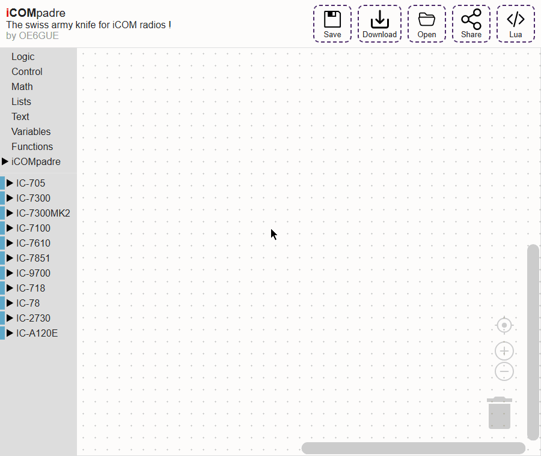

# iCOMpadre-studio

This is a blockly based IDE for iCOMpadre.

## Deployment

Download the `sdcard-studio` artifact from the latest successful
[Studio SD card package workflow run](https://github.com/bytebang/iCOMpadre-studio/actions/workflows/sdcard.yml)
and extract its contents to the root of the SD card. The artifact contains a `studio/` folder with the Studio app and its built-in help.

Try the [latest version of iCOMpadre Studio](https://bytebang.github.io/iCOMpadre-studio/demo/) online, or read the [user guide](https://bytebang.github.io/iCOMpadre-studio/documentation/).

## See it in action

For development details and instructions on adding radio support, see [DEVELOPING.md](DEVELOPING.md).

# license 

This software is dual licensed:

AGPLv3 for private use:
- You may use, copy, modify, and distribute this software under the terms of the Affero General Public License Version 3 (AGPLv3). The AGPLv3 requires that modified code, when provided over a network, be released under the AGPLv3 as well. For more information, see the [AGPLv3 license file](./sdcard/LICENSE-AGPLv3.txt).

Proprietary license for commercial use:
- A separate proprietary license is available for commercial use of this software. The proprietary license grants you additional rights and restrictions beyond the provisions of the AGPLv3. Please contact us for information on commercial licensing.

If you use, copy, modify, or distribute this software, you must comply with the respective license terms. Please refer to the specific license files for more information.

# fine print

IMPORTANT: I DO NOT ASSUME ANY RESPONSIBILITY FOR YOUR USE OF THIS SOFTWARE, AND I MAKE NO REPRESENTATIONS ABOUT ITS SAFETY, APPROPRIATENESS, OR USE FOR A PARTICULAR PURPOSE. USE OF THIS SOFTWARE IS AS-IS.

Günther Hutter - OE6GUE
