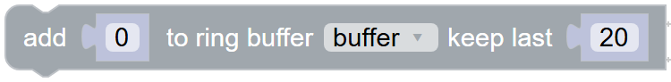
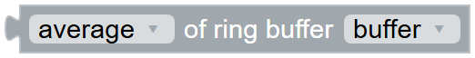

# Helpers

## Comment {#comment}

{ width="111" }

A note in your program. It does nothing, but helps you (and others) to understand the program later.

??? info "Lua code"
    ```lua
    -- limits the RF gain to 30 %
    ```

## Map {#mapnumber}

{ width="442" }

Converts a number from one range into another one.

Example: a potentiometer delivers 0 to 3.3 V, the AF level needs 0 to 100 %: *map* voltage *from range of* 0 - 3.3 *to range from* 0 - 100.

??? info "Lua code"
    ```lua
    map(readAnalogInput(PIN_A), 0, 3.3, 0, 100)
    ```

## Char of {#asChar}

{ width="90" }

Turns a number into the corresponding character, e.g. 65 into "A". Handy together with [OnSerialByte](serial.md#onserialbyte).

??? info "Lua code"
    ```lua
    string.char(65)
    ```

## Byte of character {#asByte}

{ width="160" }

The opposite of [char of](helpers.md#asChar): returns the number of the first character of a text, e.g. 65 for "A".

??? info "Lua code"
    ```lua
    string.byte("A")
    ```

## Add to ring buffer {#ringbuffer_add}

{ width="375" }

Adds a value to a list and removes the oldest values, so the list always holds the last values. This is handy to smooth a signal or to look at the last seconds.

The ring buffer is a normal [list](../blockly/lists.md) in a variable: item 1 is the oldest value, the last item the newest one. It is created by the first value, so it needs no preparation.

Example: remember the last 20 values of the [S-meter](../radio/ic705.md#ic705_get_s_meter) in [Periodically](program.md#periodically) and print their [average](#ringbuffer_get).

!!! note "How much time does the buffer hold?"
    Periodically runs about 100 times per second, so 20 values are only about 0.2 seconds. Every value costs memory and a long list takes more time: keep it to a few hundred numbers at most, and only add a value every now and then if you want to look at a longer time.

??? info "Lua code"
    ```lua
    buffer = ringAdd(buffer, 5, 20)
    ```

## Clear ring buffer {#ringbuffer_clear}

{ width="192" }

Removes all values from the ring buffer, e.g. to start again after the frequency was changed.

??? info "Lua code"
    ```lua
    buffer = {}
    ```

## Value of ring buffer {#ringbuffer_get}

{ width="261" }

Calculates one value from the numbers in the ring buffer. As long as the buffer is empty, the result is 0, also before the first value was added.

| Value | Result |
| --- | --- |
| average | the average of all values |
| minimum / maximum | the smallest / biggest value |
| range | the difference between the biggest and the smallest value: how much the signal moves |
| median | the value in the middle of the sorted values. Single outliers don't change it, unlike the average |
| standard deviation | how much the values spread around the average |
| sum | all values added up |
| newest value / oldest value | the last / the first item of the list |
| change | newest minus oldest value: positive if the signal rises, negative if it falls |
| number of values | how many values are in the buffer, e.g. to wait until it is full |

These values only work with numbers. If the ring buffer also holds texts, only *newest value*, *oldest value* and *number of values* work.

??? info "Lua code"
    ```lua
    print(ringAverage(buffer))
    ```
