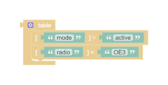
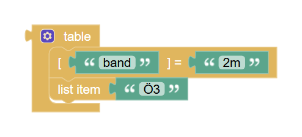
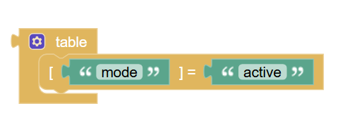
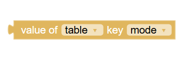
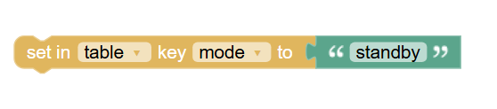

# Tables

Lua tables can be used as lists or as key-value maps, and can mix both kinds of entries. The **table** block creates a table. Use its gear icon to add or remove rows and choose whether each row is a list item or a key-value pair. Values can be any Blockly expression, including text, numbers, booleans, lists, and nested tables.

## Table with key-value pairs {#lua_table}

{ width="338" }

For example, a table can hold settings:

??? info "Lua code"
    ```lua
    {
      ["mode"] = "standby",
      ["volume"] = 42
    }
    ```

In Blockly, add a key-value row for each setting. Connect text blocks to the keys and values, then assign the result to a variable with the **set variable** block.

The generated Lua uses bracketed keys (`["name"] = value`), so keys can be expressions or strings that contain spaces and punctuation.

## List item {#lua_table_list_item}

{ width="420" }

Choose **list item** in the table's gear menu to add a value without a key. Lua assigns these values integer keys starting at 1:

??? info "Lua code"
    ```lua
    "80m",
    ```

List items and key-value pairs can be mixed in one table. List items are also available in the Tables category; when used outside a table, a complete item creates a temporary table and Blockly shows a warning. An item without a value is omitted.

## Key-value pair {#lua_table_entry}

{ width="420" }

The **key-value pair** block is also available on its own in the Tables category. Connect expressions to its key and value inputs, then place it in a statement list or a table. The table block's gear icon creates these same rows inside a table.

For safety, a complete pair used outside a table generates a temporary local table instead of invalid Lua. Blockly also warns that the pair belongs inside a table. Rows with a missing key or value are omitted.

??? info "Lua code"
    ```lua
    ["mode"] = "standby",
    ```

## Read a value by key {#lua_table_get}

{ width="338" }

Use the **value of** block to read an entry from a table variable. Select the table variable, then choose a key from the dropdown. The dropdown is populated from literal text, number, and boolean keys in tables assigned directly to that variable.

For example, after assigning the settings table above to `settings`, choose `settings` and `mode` to generate:

??? info "Lua code"
    ```lua
    settings["mode"]
    ```

Keys made from other expressions are not listed in the dropdown.

## Set a value by key {#lua_table_set}

{ width="460" }

Use the **set in** block to update one entry in a table variable. Select the table and key, then connect the new value. The key dropdown uses the same literal keys as the read block.

For example, selecting `settings` and `mode` generates:

??? info "Lua code"
    ```lua
    settings["mode"] = "active"
    ```
