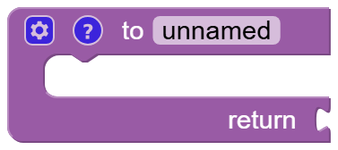

# Functions

A function gives a group of blocks a name. Afterwards the whole group can be used in several places with a single block, so you don't have to build it again and again.

As soon as you have created a function, a block to call it appears in this category.
Click on the gear icon of a function to add inputs. They can be used like [variables](variables.md) inside the function.

!!! warning "Choose your own names"
    Don't name your functions like the events or blocks of iCOMpadre, e.g. *periodically* or *wait*. They would replace the original ones.

---

## To do something {#procedures_defnoreturn}

{ width="180" }

Defines a function which executes the blocks in it. Replace *do something* with a name that tells what the function does.

Example: a function *warn* which prints "Attention!".

??? info "Lua code"
    ```lua
    function warn()
      print('Attention!')
    end
    ```

---

## To do something and return {#procedures_defreturn}

{ width="188" }

Defines a function which calculates a value. The value at *return* is the result of the function.

Example: a function *toKHz* with the input *freq*, which returns *freq ÷ 1000*.

??? info "Lua code"
    ```lua
    function toKHz(freq)
      return freq / 1000
    end
    ```

---

## If return {#procedures_ifreturn}

{ width="146" }

Can only be used inside a function. If the condition is true, the function ends right here and returns the given value.

Example: *if* freq < 10000000 *return* "low band".

??? info "Lua code"
    ```lua
    function band(freq)
      if freq < 10000000 then
        return 'low band'
      end
      return 'high band'
    end
    ```

---

## Call function {#procedures_callnoreturn}

{ width="117" }

Executes a function that was defined with [to do something](#procedures_defnoreturn). The block has the name of the function.

??? info "Lua code"
    ```lua
    function periodically()
      if level > 80 then
        warn()
      end
    end
    ```

---

## Call function with result {#procedures_callreturn}

{ width="125" }

Executes a function that was defined with [to do something and return](#procedures_defreturn), and provides its result, so it can be plugged into other blocks.

Example: print *toKHz* 7074000 prints 7074.0.

??? info "Lua code"
    ```lua
    print(toKHz(7074000))
    ```
