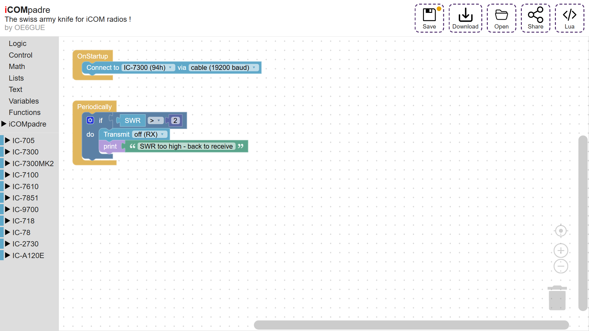
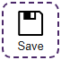
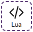

# Editor

The toolbox with the [blocks](blocks.md) is on the left side, your program (the *sketch*) in the middle.

## Action Buttons

The dashed buttons at the top right:

| Button                      | Functionality                 |
|-----------------------------|-------------------------------|
|     | The **save** button compiles the current sketch and stores it on iCOMpadre (as `main.lua` and `icompadre.json`). `ctrl+s` does the same. A dot on the button shows that there are unsaved changes. Next to the buttons you can see whether saving worked. |
|     | The **download** button downloads the current sketch to your computer. The filename contains the date, e.g. `icompadre-2024-12-31.json`. |
|     | The **open** button replaces the current sketch with one that you select from your computer. You can also drop the file onto the button. `ctrl+z` brings the previous sketch back. |
|     | The **share** button shows the current sketch as text, so it can be shared via mail, pastebin or other techniques. Paste the text of someone else's sketch there and press **Import** to open it. |
|     | The **lua** button shows the lua code which is generated from the sketch, next to the workspace. It is updated while you work. From there it can be copied or downloaded as `main.lua`. |
|  | The **help** button opens this user guide in a new tab. |

## Unsaved changes

Changes which are not saved on iCOMpadre yet are kept in your browser. If the browser is closed (or crashes) before you save, the studio offers to restore them the next time you open it.

## Help and warnings

* **Help:** right click on a block of iCOMpadre or a radio and choose *Help*. It opens the description of the block in this guide.
* **Warnings:** a block with a problem shows a warning sign. Click on it to see what is wrong, e.g. an event block which is in the program more than once.
* **Undo:** `ctrl+z` undoes the last change, `ctrl+y` redoes it. This works also after opening or importing a sketch.

## Sharing your programs

If you have a cool solution that you want to share with others, please do so, by pasting it onto [pastebin](https://pastebin.com/) with the hashtag `#icompadre`. The title should give a hint what the solution is about.
The [share button](#action-buttons) shows your sketch as text, ready to be pasted. With the same button you can import the sketch of someone else.
