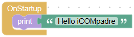
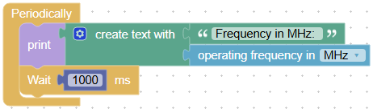
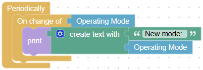
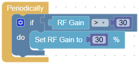
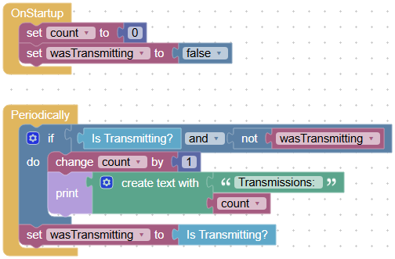

# Tutorial

Five small programs, each one shows one idea you need for your own programs. They are written for the IC-705, for another radio take the blocks of its category instead
(and [connect to it](base/radio.md#connect_radio) first).

Every program can be downloaded and opened in the studio with the [open button](editor.md#action-buttons). Press *Save* to store it on iCOMpadre,
it runs the next time iCOMpadre starts in the RUN mode. To see what the programs print, connect iCOMpadre via USB to your computer and open a terminal program with 115200 baud (see [Serial](base/serial.md)).

## 1. Hello iCOMpadre {#hello}

**What you learn:** events, and where your program prints its messages.

{ width="254" }

Programs are made of [events](blocks.md#kinds-of-blocks): blocks which iCOMpadre executes at a certain time. [OnStartup](base/program.md#onstartup) is executed once, when iCOMpadre starts.
[Print](base/serial.md#text_print) writes a text to the serial interface. It is your most important tool to find out what your program does.

**Try it yourself:** print a second line with your callsign.

[Download hello.json](tutorial/hello.json){ download="hello.json" }

## 2. Reading values from the radio {#reading}

**What you learn:** [Periodically](base/program.md#periodically) and how blocks read values from the radio.

{ width="454" }

Periodically is executed over and over again. Here it prints the frequency of the radio, and then [waits](base/program.md#wait) a second, otherwise the terminal would be flooded with lines.
[Create text with](blockly/text.md#text_join) puts the label and the value together into one line.

The first lines may show the frequency 0: blocks that read a value use the [last answer](blocks.md#reading-values) of the radio, and right after the start there is no answer yet.

**Try it yourself:** print the [S-meter](radio/ic705.md#ic705_get_s_meter) as well.

[Download frequency.json](tutorial/frequency.json){ download="frequency.json" }

## 3. Reacting to changes {#changes}

**What you learn:** to do something only when a value **changes**.

{ width="394" }

In the program above the frequency is printed every second, even if nothing changes. [On change of](base/program.md#onchangeof) watches a value and executes its blocks only when the value is different from the last time.
Change the mode on the radio: every new mode is printed once.

**Try it yourself:** watch the frequency instead of the mode, and print it only when you turn the dial. The wait block is not needed anymore.

[Download change.json](tutorial/change.json){ download="change.json" }

## 4. Keeping a value within a limit {#limit}

**What you learn:** conditions with [if](blockly/control.md#controls_if) and [compare](blockly/logic.md#logic_compare), and changing a setting of the radio.

{ width="276" }

If the RF gain is higher than 30 %, it is set back to 30 %. You can still turn the RF gain knob down, but never above 30 %. This is the program of the [video on the overview page](index.md#general-usage).

This is a pattern for many programs: *if a value is outside of a limit, then set it back*. It protects e.g. a preamp, an amplifier at the output or the radio itself.

**Try it yourself:** limit the [RF power](radio/ic705.md#ic705_set_rf_power) to 50 %, or switch back to receive (*Transmit off*) if the [SWR](radio/ic705.md#ic705_get_swr_meter_level) is higher than 2.5.

[Download limiter.json](tutorial/limiter.json){ download="limiter.json" }

## 5. Remembering things with variables {#variables}

**What you learn:** [variables](blockly/variables.md), their start value, and how to notice the moment when something starts.

{ width="496" }

The program counts how often you transmit. *Is Transmitting?* alone is true during the whole transmission, so counting it in Periodically would count many times per transmission.
The variable *wasTransmitting* remembers the state of the last run: the counter only increases when the radio transmits **now**, but did **not** before. At the end of every run *wasTransmitting* gets the current state.

Both variables get their start value in [OnStartup](base/program.md#onstartup). Without it, *count* would have no value and the program would stop with an error message on the serial interface.

**Try it yourself:** also print when the transmission ends (transmitting before, but not now). With [Milliseconds since start](base/program.md#millis) you can even print how long it took.

[Download counter.json](tutorial/counter.json){ download="counter.json" }

## What next?

* Look through the blocks of [iCOMpadre](base/program.md) and of [your radio](base/radio.md#radios), every block has an example.
* [Remember](base/storage.md#storage_remember) values on the SD card, so they survive a restart, or log values into a [CSV file](base/storage.md#storage_append_csv).
* Use the [pins](base/pins.md) to read a foot switch or to switch an LED or relay.
