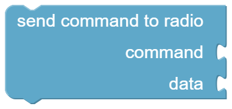

# Radio

With these blocks you select the radio iCOMpadre talks to, and you can send any CI-V command to it, even if there is no ready-made block for it in the category of your radio.
The commands are described in the *CI-V reference guide* of your radio. Commands and answers are [lists](../blockly/lists.md) of numbers.

## Radios {#radios}

The radios which have their own category in the toolbox, with their default CI-V address:

| Radio | CI-V address | Connection |
|-------|--------------|------------|
| [IC-705](../radio/ic705.md) | A4h | Bluetooth (default, no *Connect* block needed) |
| [IC-7300](../radio/ic7300.md) | 94h | cable |
| [IC-7300MK2](../radio/ic7300mk2.md) | B6h | cable |
| [IC-7100](../radio/ic7100.md) | 88h | cable |
| [IC-7610](../radio/ic7610.md) | 98h | cable |
| [IC-7851](../radio/ic7851.md) | 8Eh | cable |
| [IC-9700](../radio/ic9700.md) | A2h | cable |
| [IC-718](../radio/ic718.md) | 5Eh | cable |
| [IC-78](../radio/ic78.md) | 62h | cable |
| [IC-2730](../radio/ic2730.md) | 90h | cable |
| [IC-A120E](../radio/ica120e.md) | 92h | cable |

Other Icom radios can be used with [Connect to CI-V address](#connect_address) and the blocks [Send command to radio](#sendcommand) and [Read data from radio](#readdata).

## Connect to radio {#connect_radio}

{ width="390" }

Selects the radio iCOMpadre talks to, and how it is connected:

* **Bluetooth** for the IC-705, which has no REMOTE jack. This is what iCOMpadre does if there is no *Connect* block.
* **cable** for all other radios: connect the REMOTE jack of the radio to iCOMpadre with a mono cable (see [Radios](../../radios.md)). Choose the baud rate which is set as *CI-V Baud Rate* in the menu of the radio, or set the radio to *Auto*.

The block uses the default CI-V address of the radio, e.g. 94h for the IC-7300. Put it into [OnStartup](program.md#onstartup), so it is executed before iCOMpadre talks to the radio.

??? info "Lua code"
    ```lua
    configCIV(0x98, "cable", 19200)   -- IC-7610 at the REMOTE jack
    configCIV(0xA4, "bluetooth")      -- IC-705
    ```

## Connect to CI-V address {#connect_address}

{ width="403" }

Like [Connect to radio](radio.md#connect_radio), but with the CI-V address in hex (01 ~ DF), as it is set in the menu of the radio.
You need it if you changed the address, e.g. because two radios of the same type share the CI-V bus.

??? info "Lua code"
    ```lua
    configCIV(0x96, "cable", 9600)
    ```

## Send command to radio {#sendcommand}

{ width="190" }

Sends a command (and optional data) to the radio. Both are [lists](../blockly/lists.md) of numbers.

Example: *command* = list with 20, 1 (`0x14 0x01`, AF level) and *data* = list with 1, 40 (`0x01 0x28`, the BCD value of 128) sets the AF level to about 50 %.

??? info "Lua code"
    ```lua
    sendCommand({20, 1}, {1, 40})
    ```

## Read data from radio {#readdata}

{ width="183" }

Sends a command to the radio and returns its answer as [list](../blockly/lists.md) of numbers.

Example: *Read data from radio* with the list 20, 1 returns the current AF level.

??? info "Lua code"
    ```lua
    readResultOfCommand(sendCommand({20, 1}))
    ```

## BCD values as number {#bcdasnumber}

{ width="198" }

Many radios send numbers as *BCD*: every half byte is one decimal digit. This block turns such an answer into a normal number, e.g. the list `0x01, 0x28` into 128.

??? info "Lua code"
    ```lua
    bcdToNumber(readResultOfCommand(sendCommand({20, 1})))
    ```

## Pretty {#prettystring}

{ width="82" }

Turns a list of numbers into a readable text with hexadecimal values, e.g. `{0x14 ,0x01 }`. Combine it with [print](serial.md#text_print) to see what the radio answers.

??? info "Lua code"
    ```lua
    print(pretty(readResultOfCommand(sendCommand({20, 1}))))
    ```
