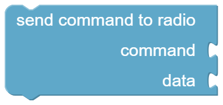

# iCOMpadre

The blocks of the category *iCOMpadre* work with iCOMpadre itself: when your program runs, the connection to the radio, the pins of the connector and the serial interface.
They are grouped by topic, and every group has its own colour:

| Group | Colour | Content |
|-------|--------|---------|
| [Program](#program) | <span style="color:#e0b65e">■</span> sand | when your program runs, timing |
| [Radio](#radio) | <span style="color:#5fa8c9">■</span> blue | sending your own CI-V commands to the radio |
| [Pins](#pins) | <span style="color:#9cc46b">■</span> green | inputs and outputs of the iCOMpadre connector |
| [Serial](#serial) | <span style="color:#b39ddb">■</span> lavender | the serial interface |
| [Helpers](#helpers) | <span style="color:#a0a7ad">■</span> grey | conversions and comments |

The blocks of the radios (e.g. [IC-705](radio/ic705.md)) are blue as well, because they also talk to the radio.

---

## <span style="color:#e0b65e">■</span> Program {#program}

Events start your program, the other blocks control when something happens.

### OnStartup {#onstartup}

{ width="96" }

The blocks in here are executed **once**, when iCOMpadre starts. Use it to give your [variables](variables.md) a start value, or to set the pins and the serial interface up.

??? info "Lua code"
    ```lua
    function onStartup()
      level = 0
    end
    ```

### Periodically {#periodically}

{ width="104" }

The blocks in here are executed **over and over again**, as long as a radio is connected. This is the place for everything that should react to the radio, e.g. a limiter that watches the RF gain.

Keep the blocks in here short: iCOMpadre talks to the radio in between, and long programs slow that down.

??? info "Lua code"
    ```lua
    function periodically()
      ...
    end
    ```

### On change of {#onchangeof}

{ width="125" }

Executes the inner blocks only when the watched value **changes**, and not every time. Put it into [Periodically](#periodically).

Example: *On change of* the operating mode, print the new mode. The mode is printed once after every change, instead of all the time.

??? info "Lua code"
    ```lua
    local actValue = getOperatingModeString(readResultOfCommand(sendCommand({0x04})))
    if(_G.lastValue ~= actValue ) then _G.lastValue = actValue
      print(actValue)
    end
    ```

### Wait {#wait}

{ width="118" }

Pauses your program for the given time in milliseconds (1000 ms = 1 second). iCOMpadre keeps talking to the radio while waiting.

Example: switch a pin on, *wait* 500 ms, switch it off again.

??? info "Lua code"
    ```lua
    wait(500)
    ```

### Execute Lua chunk {#executeluachunk}

{ width="163" }

Runs a piece of Lua code that is given as text. For experienced users who want to do something that no block offers. The *Help* of this block opens the Lua manual.

??? info "Lua code"
    ```lua
    load('print(1 + 2)')()
    ```

### Milliseconds since start {#millis}

{ width="188" }

The time since iCOMpadre was started, in milliseconds. Useful to measure how long something takes, or to do something only every few seconds. After about 49 days it starts at 0 again.

??? info "Lua code"
    ```lua
    millis()
    ```

---

## <span style="color:#5fa8c9">■</span> Radio {#radio}

With these blocks you can send any CI-V command to the radio, even if there is no ready-made block for it in the category of your radio.
The commands are described in the *CI-V reference guide* of your radio. Commands and answers are [lists](lists.md) of numbers.

### Send command to radio {#sendcommand}

{ width="190" }

Sends a command (and optional data) to the radio. Both are [lists](lists.md) of numbers.

Example: *command* = list with 20, 1 (`0x14 0x01`, AF level) and *data* = list with 1, 40 (`0x01 0x28`, the BCD value of 128) sets the AF level to about 50 %.

??? info "Lua code"
    ```lua
    sendCommand({20, 1}, {1, 40})
    ```

### Read data from radio {#readdata}

{ width="183" }

Sends a command to the radio and returns its answer as [list](lists.md) of numbers.

Example: *Read data from radio* with the list 20, 1 returns the current AF level.

??? info "Lua code"
    ```lua
    readResultOfCommand(sendCommand({20, 1}))
    ```

### BCD values as number {#bcdasnumber}

{ width="198" }

Many radios send numbers as *BCD*: every half byte is one decimal digit. This block turns such an answer into a normal number, e.g. the list `0x01, 0x28` into 128.

??? info "Lua code"
    ```lua
    bcdToNumber(readResultOfCommand(sendCommand({20, 1})))
    ```

### Pretty {#prettystring}

{ width="82" }

Turns a list of numbers into a readable text with hexadecimal values, e.g. `{0x14 ,0x01 }`. Combine it with [print](#text_print) to see what the radio answers.

??? info "Lua code"
    ```lua
    print(pretty(readResultOfCommand(sendCommand({20, 1}))))
    ```

---

## <span style="color:#9cc46b">■</span> Pins {#pins}

iCOMpadre has 8 pins (A to H) on its connector, to which you can connect switches, LEDs, relays or sensors.
All pins work with voltages between 0 V and 3.3 V.

### Set PIN to voltage {#setanalogoutput}

{ width="130" }

Sets PIN A or PIN B to a voltage between 0 V and 3.3 V. Only these two pins can output a voltage.

Example: *Set PIN A to Voltage* 1.65 V.

??? info "Lua code"
    ```lua
    setAnalogOutput(PIN_A, 1.65)
    ```

### Set PIN to value {#setdigitaloutput}

{ width="130" }

Switches a pin on (*true*, 3.3 V) or off (*false*, 0 V), e.g. to light an LED or to switch a relay.

??? info "Lua code"
    ```lua
    setDigitalOutput(PIN_C, true)
    ```

### Voltage of PIN {#readanaloginput}

{ width="173" }

Measures the voltage at a pin, in volts (0 to 3.3 V). Use it e.g. with a potentiometer.

??? info "Lua code"
    ```lua
    readAnalogInput(PIN_A)
    ```

### State of PIN {#readdigitalinput}

{ width="158" }

Checks whether a pin is high (*true*) or low (*false*), e.g. if a switch is closed.

??? info "Lua code"
    ```lua
    readDigitalInput(PIN_C)
    ```

### Touch value of PIN {#touchvalue}

{ width="203" }

Pins C to H can be used as touch sensors: just connect a piece of metal. This block returns the raw measurement. The value **drops** when the pin is touched.
Use it to find the right threshold for your setup, otherwise [Is PIN touched](#isTouched) is easier to use.

??? info "Lua code"
    ```lua
    readTouchInput(PIN_C)
    ```

### Is PIN touched {#isTouched}

{ width="226" }

*True* if a touch pin is *touched* (or *released*, depending on the selection). Touched means a [touch value](#touchvalue) below 30.

Example: *if Is PIN C touched* then select VFO A.

??? info "Lua code"
    ```lua
    (readTouchInput(PIN_C) < 30)
    ```

### Voltage {#voltagevalue}

{ width="94" }

A number with the unit *V* or *mV*. It makes programs easier to read: plug it into [Set PIN to voltage](#setanalogoutput), e.g. 500 mV.

??? info "Lua code"
    ```lua
    setAnalogOutput(PIN_A, 0.5)     -- 500 mV
    ```

---

## <span style="color:#b39ddb">■</span> Serial {#serial}

iCOMpadre has a serial interface (USB). Connect it to a computer and open a terminal program to see what your program prints, or to send commands to it.
The default speed is 115200 baud.

### OnSerialLine {#onserialline}

{ width="144" }

Executed whenever a complete line (finished with *Enter*) arrives on the serial interface. The variable *line* contains the text.

Example: if *line* = "vfo a" then select VFO A. This way you can control the radio from a computer.

??? info "Lua code"
    ```lua
    function onSerialLine(line)
      ...
    end
    ```

### OnSerialByte {#onserialbyte}

{ width="145" }

Executed for every single byte that arrives on the serial interface. The variable *byte* contains its value as number. Use [char of](#asChar) to turn it into a character.

??? info "Lua code"
    ```lua
    function onSerialByte(byte)
      ...
    end
    ```

### Print {#text_print}

{ width="66" }

Prints a text, a number or another value on the serial interface. The most important block to find out what your program is doing.

??? info "Lua code"
    ```lua
    print('Hello iCOMpadre')
    ```

### Set serial speed {#configserial}

{ width="249" }

Changes the speed of the serial interface, e.g. to talk to a device that only understands 9600 baud. Put it into [OnStartup](#onstartup).

??? info "Lua code"
    ```lua
    configSerial(9600)
    ```

---

## <span style="color:#a0a7ad">■</span> Helpers {#helpers}

### Comment {#comment}

{ width="111" }

A note in your program. It does nothing, but helps you (and others) to understand the program later.

??? info "Lua code"
    ```lua
    -- limits the RF gain to 30 %
    ```

### Map {#mapnumber}

{ width="442" }

Converts a number from one range into another one.

Example: a potentiometer delivers 0 to 3.3 V, the AF level needs 0 to 100 %: *map* voltage *from range of* 0 - 3.3 *to range from* 0 - 100.

??? info "Lua code"
    ```lua
    map(readAnalogInput(PIN_A), 0, 3.3, 0, 100)
    ```

### Char of {#asChar}

{ width="90" }

Turns a number into the corresponding character, e.g. 65 into "A". Handy together with [OnSerialByte](#onserialbyte).

??? info "Lua code"
    ```lua
    string.char(65)
    ```

### Byte of character {#asByte}

{ width="160" }

The opposite of [char of](#asChar): returns the number of the first character of a text, e.g. 65 for "A".

??? info "Lua code"
    ```lua
    string.byte("A")
    ```
