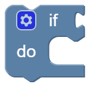
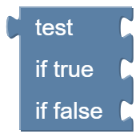

# Control

Control blocks decide **which** blocks are executed and **how often**.

!!! note "There is no endless loop"
    You don't need a *repeat forever* block: [Periodically](base.md#periodically) is already executed over and over again.
    Keep the blocks in there short, so iCOMpadre has enough time to talk to the radio.

---

## If {#controls_if}

{ width="75" }

Executes the blocks in *do* only if the condition at *if* is true. Otherwise they are skipped.

Click on the gear icon to extend the block:

* **else if** adds a further condition. The conditions are checked one after another, only the first one that is true is executed.
* **else** is executed if none of the conditions is true.

Example: *if* AF Level > 80 *do* print "loud", *else if* AF Level > 30 *do* print "normal", *else* print "quiet".

??? info "Lua code"
    ```lua
    if level > 80 then
      print('loud')
    elseif level > 30 then
      print('normal')
    else
      print('quiet')
    end
    ```

---

## Test {#logic_ternary}

{ width="87" }

Chooses between two values: if the condition at *test* is true, the block returns the value at *if true*, otherwise the value at *if false*.
It is a short form of the if block, which can be plugged in wherever a value is expected.

Example: *test* AF Level > 50, *if true* "loud", *if false* "quiet".

!!! warning
    If the value at *if true* is *false* itself, the block always returns the value at *if false*. Use an [if block](#controls_if) in this case.

??? info "Lua code"
    ```lua
    message = level > 50 and 'loud' or 'quiet'
    ```

---

## For each item in list {#controls_forEach}

{ width="195" }

Executes the blocks in *do* once for every item of a [list](lists.md). The variable (*i*) contains the current item.

Example: for each item in the list *7000000, 14000000, 21000000*, print the item. This prints the three frequencies one after another.

??? info "Lua code"
    ```lua
    for _, item in ipairs({7000000, 14000000, 21000000}) do
      print(item)
    end
    ```

---

## Break out / continue {#controls_flow_statements}

{ width="160" }

Can only be used inside a [for each](#controls_forEach) block:

* **break out** ends the loop immediately. The remaining items are not processed.
* **continue with next iteration** skips the rest of the blocks for the current item and continues with the next one.

??? info "Lua code"
    ```lua
    for _, item in ipairs({1, 2, 3}) do
      if item == 2 then
        break                -- prints only 1
      end
      print(item)
    end

    for _, item in ipairs({1, 2, 3}) do
      if item == 2 then
        goto continue        -- prints 1 and 3
      end
      print(item)
      ::continue::
    end
    ```
